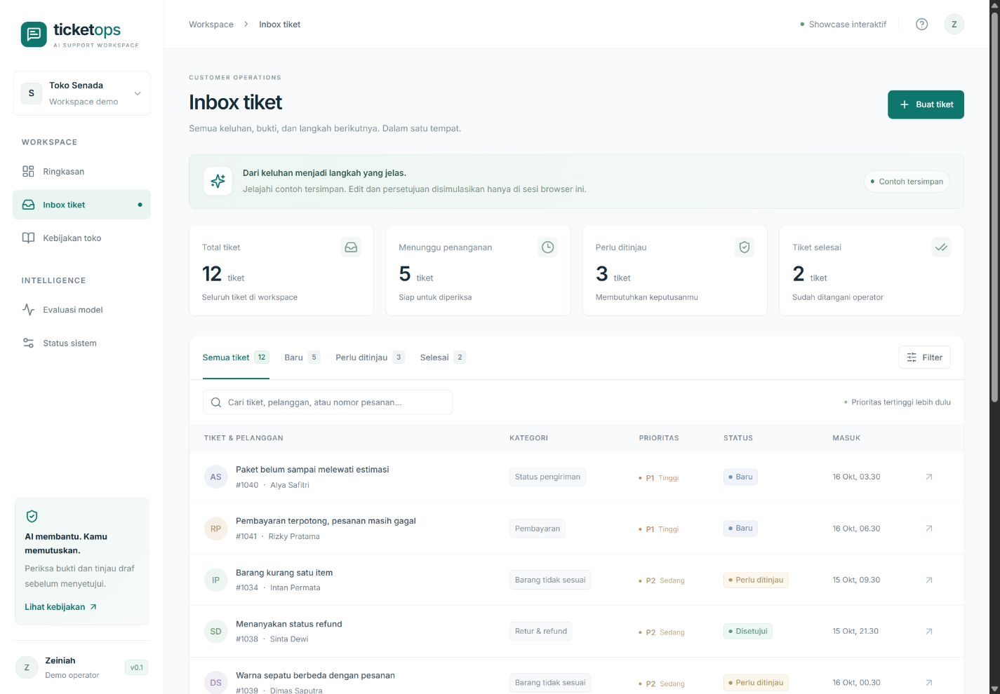

# TicketOps

**Workspace customer support berbahasa Indonesia: klasifikasi keluhan, pencarian kebijakan, draf jawaban, dan keputusan operator.**

React + TypeScript · FastAPI · PostgreSQL/SQLite · scikit-learn · Ollama/Qwen · pipeline IndoBERT untuk Colab



Tampilan memakai palet slate–teal, font Inter lokal, dan layout responsif. Screenshot menunjukkan contoh tersimpan, bukan hasil inferensi yang diklaim langsung.

## Status yang benar-benar tersedia

- Aplikasi lokal lengkap: inbox, filter, detail tiket, koreksi, draf, persetujuan, penyelesaian, kebijakan, dan dashboard.
- Classifier TF-IDF dilatih pada 1.600 baris sintetis; development 200, calibration 200, test 320.
- Qwen3 4B lokal sudah diuji melalui alur HTTP sampai persetujuan dan penyelesaian; rekaman di [`docs/local-smoke.json`](docs/local-smoke.json).
- Dashboard evaluasi menampilkan hasil terukur: macro-F1 terkalibrasi awal **0,744** pada test sintetis (64 keluarga skenario), di bawah target desain 0,80.
- Showcase hosting memakai contoh tersimpan. Input bebas dan generation langsung berjalan di versi lokal.
- Skrip fine-tuning IndoBERT dan notebook Colab tersedia; **training IndoBERT belum dijalankan**.
- Data bootstrap ditulis coding agent dan **belum ditinjau manusia**. Seluruh prediksi memerlukan review operator.

## Jalankan di Windows

Prasyarat: Node.js 24, Python 3.12, `uv`, dan Ollama bila ingin generation LLM. Laptop RAM 16 GB adalah profil pengembangan, bukan jaminan latency.

```powershell
ollama pull qwen3:4b
powershell -File scripts/start-local.ps1 -Install
```

Buka **http://127.0.0.1:5178**. Dokumentasi API tersedia di **http://127.0.0.1:8018/docs**. Model Ollama harus tersedia pada layanan lokal; bila layanan tidak tersedia, aplikasi memberikan template berlabel.

Untuk penggunaan berikutnya:

```powershell
powershell -File scripts/start-local.ps1
```

Gunakan `-NoLLM` untuk menjalankan classifier + template. `Ctrl+C` menghentikan frontend beserta proses API/worker yang dibuat skrip. Tidak perlu menyalakan server Ollama kedua jika aplikasi Ollama sudah berjalan.

## Jalankan manual atau Linux/macOS

```bash
uv venv --python 3.12 .venv
uv pip install --python .venv/bin/python -e './backend[dev]'
npm ci
source .venv/bin/activate
python ml/train_baseline.py
alembic -c backend/alembic.ini upgrade head
```

Jalankan di tiga terminal dari root proyek: `uvicorn ticketops.main:app --host 127.0.0.1 --port 8018`, `python -m ticketops.worker`, dan `VITE_MODE=api npm run dev`. Di Windows gunakan `.venv/Scripts/python.exe` dan `$env:VITE_MODE='api'`.

## PostgreSQL melalui Docker

Siapkan baseline di host, kemudian:

```bash
docker compose up --build
```

Frontend tetap di port 5178 dan API 8018. Data PostgreSQL memakai named volume. Ollama berada di host. Konfigurasi ini disediakan tetapi belum dijalankan pada mesin pengembangan ini karena Docker tidak tersedia. Jangan menjalankan versi Docker dan quickstart bersamaan pada port yang sama.

## Pengembangan frontend

```bash
npm ci
npm run dev
npm run build
npm test
```

Default Vite tanpa `VITE_MODE=api` adalah showcase, sehingga build hosting tidak diam-diam mengirim data ke localhost pengunjung. Pengujian selalu menjalankan mode showcase secara eksplisit. Font Inter disimpan lokal. Palet memakai off-white, slate, dan teal; warna amber digunakan untuk review dan merah untuk kesalahan.

## Pipeline ML

```bash
python ml/build_dataset.py
python ml/train_baseline.py
python ml/benchmark_qwen.py --per-class 40
```

Perintah benchmark Qwen adalah eksperimen tambahan yang bisa memakan waktu lama di CPU. Tidak ada skor Qwen classification yang diklaim sebelum eksperimen dijalankan. Notebook [`ml/TicketOps_Training.ipynb`](ml/TicketOps_Training.ipynb) menjelaskan kandidat IndoBERT, pemilihan konfigurasi, serta ekspor model.

Hasil baseline dan model terlatih ditulis ke `ml/artifacts/` (diabaikan Git). Hasil yang sudah diekspor ke showcase tetap membawa tanggal serta provenance eksperimen. Setelah eksperimen baru, restart API dan jalankan `python scripts/export_showcase.py` untuk mengekspor sebuah sesi contoh baru yang terisolasi.

## Pengujian

```bash
python -m pytest backend/tests -q
npm test
npm run build
python scripts/smoke_local.py
```

Test backend memakai database SQLite terpisah di `work/test-ticketops.db`. Smoke test membutuhkan API, worker, dan Qwen aktif; seluruh inputnya sintetis. Smoke ini memeriksa integrasi, bukan kualitas model secara umum.

## Dokumentasi

- [`docs/ARCHITECTURE.md`](docs/ARCHITECTURE.md): runtime, revisi, antrean, sesi, dan mode demo.
- [`docs/EVALUATION.md`](docs/EVALUATION.md): target, hasil aktual, serta evaluasi manusia yang masih dibutuhkan.
- [`ml/DATASET_CARD.md`](ml/DATASET_CARD.md): asal data, split, dan keterbatasan benchmark.
- [`ml/MODEL_CARD.md`](ml/MODEL_CARD.md): classifier, generation, kalibrasi, dan promosi model.

## Batas penggunaan

Ini portofolio yang dapat dijalankan, bukan klaim layanan produksi. Tidak ada kiriman pesan eksternal, transaksi refund, data pesanan asli, atau online retraining. Integrasi pengguna nyata memerlukan autentikasi yang sesuai, retensi data, evaluasi representatif, serta peninjauan manusia.

Lisensi MIT untuk source proyek. Hormati lisensi masing-masing dependency dan model. Dibuat untuk portofolio Zeiniah.
